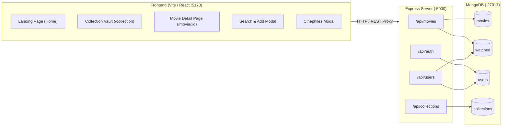

# Reelbox — Personal Cinema, Curated

> A full-stack MERN (MongoDB, Express, React, Node.js) web platform for movie lovers, series bingers, and anime enthusiasts to log stories, write personal reviews, organize titles into custom shelves, and discover fellow cinephiles.

---

## Table of Contents
- [Overview](#overview)
- [Key Features](#key-features)
- [Tech Stack](#tech-stack)
- [System Architecture](#system-architecture)
- [Database Schema](#database-schema)
- [API Endpoints](#api-endpoints)
- [Getting Started](#getting-started)
  - [Prerequisites](#prerequisites)
  - [Environment Variables](#environment-variables)
  - [Installation & Seeding](#installation--seeding)
  - [Running the App](#running-the-app)
- [Project Directory Structure](#project-directory-structure)
- [Available Scripts](#available-scripts)
- [License](#license)

---

## Overview

**Reelbox** transforms film tracking from a dry spreadsheet into an aesthetic, personal cinema vault and diary. Every user gets a private collection where database titles start unwatched by default. Users can search the global catalog, log titles with custom ratings and diary notes, assign them to themed shelves (like *Late Night*, *Mind Benders*, or *Comfort Movies*), explore community reviews, and search for fellow cinephiles to inspect their vaults and favorite picks.

---

## Key Features

### 🎬 Personal Cinema Vault & Full CRUD
- **Unwatched by Default**: Every user starts with a clean slate; database catalog titles remain unwatched until explicitly logged.
- **Full CRUD Anywhere**:
  - **Create**: Add from catalog suggestions, or create brand-new cinema titles with custom poster uploads.
  - **Read**: Explore personal collections filtered by Watched, Favorites, Watchlist, Formats, and Custom Shelves.
  - **Update**: Hover over any movie card in your library to open **Edit (✎)** to change ratings, personal notes, collection shelves, or toggle between Watched and Watchlist.
  - **Delete**: Quick-delete (**🗑**) any movie entry from your library cards or dedicated movie pages, and delete custom collection shelves from the Collections manager.
- **Watchlist vs. Watched Isolation**:
  - Toggling between **Watched** and **Save to Watchlist** renders a completely different interface.
  - Titles saved to Watchlist are strictly isolated from Watched stories (they do not count toward your Watched tally and do not clutter your Watched shelves).
  - Users **cannot rate or review titles they haven't watched**. Rating and review inputs are locked until the user marks the story as watched.

### 📚 Interactive Collection Shelves & CRUD
- **Themed Organization**: Organize titles into curated shelves such as *Late Night*, *Mind Benders*, *Comfort Movies*, and *Weekend Picks*, or create custom shelves on the fly.
- **Shelf Deletion**: Remove custom collection shelves with a single click in the Collections modal (`🗑`), safely unfiling associated movies without deleting them.
- **Interactive Shelf Filtering**: Clicking any shelf in the Collections modal filters your library dynamically to that shelf with active badges (`Shelf: Late Night ✕`).
- **Unified Shelf Assignment**: Select or change the assigned shelf when searching a title, logging a new entry, modifying an existing card, or writing a review on the dedicated movie page.

### 🔍 Search-First Logging & Direct Poster Navigation
- **Clickable Recommendation Posters**: While searching for titles, clicking the poster or title in the recommendation list enters the dedicated `/movie/:id` page directly.
- **Instant Autocomplete**: Search catalog titles with debounced live suggestions.
- **No Repeated Records**: Selecting an existing title opens the quick-curate dialog without duplicating the title in the database.
- **Add Brand New Cinema**: If a title isn't listed, users can add a brand-new **Movie**, **Series**, or **Anime** with title, release year, genre, synopsis, and custom poster upload.
- **Posters in Database**: Uploaded poster files are converted to Base64 and stored directly in MongoDB (supports payloads up to 25MB).

### 📖 Dedicated Movie Detail Pages (`/movie/:id`)
- **Cinematic Header**: High-contrast poster, release year, format badge, and storyline synopsis.
- **Unwatched Review Gate**: Unwatched titles display a locked gate prompting the user to *"Mark as Watched"* before rating or leaving a review.
- **Amazon-Style Community Reviews**: Scroll through ratings and in-depth reviews written by other cinephiles with verified reviewer avatars, dates, and shelf tags.
- **Personal Diary Box**: Write or update your own review and rating directly on the cinema page, or remove the entry from your library with `🗑 Remove from My Reelbox`.

### 🌟 Home Page Recommendations
- **Unwatched Recommendations**: Dynamically fetches and suggests catalog stories from MongoDB that you have not watched yet.
- **Direct Navigation**: Clicking any recommended card takes you straight to its dedicated detail page.

### 👥 Explore Cinephiles (Community Discovery)
- **Search by Username**: Search cinephiles by their username without leaking or listing all registered users by default.
- **Public Profile Inspection**: View any cinephile's bio, total logged stories, favorites count, watchlist count, and recent reviews.

### 🎨 Modern Glassmorphic Interface
- Unified floating navigation capsule (`.nav-common-bar`) on the landing page.
- Fully responsive dark cinema aesthetic with fluid typography, responsive grids, and subtle micro-interactions.

---

## Tech Stack

| Layer | Technologies |
| :--- | :--- |
| **Frontend** | React 18 / 19, React Router DOM v6, Vite, Vanilla CSS3 (Custom Glassmorphism, Flexbox, CSS Grid) |
| **Backend** | Node.js (ES Modules), Express v5 |
| **Database** | MongoDB with Mongoose v9 ORM |
| **Authentication** | bcryptjs (Salted password hashing), LocalStorage session state |
| **Security & Utilities** | Regex sanitization against ReDoS attacks, CORS, Dotenv, Concurrently |

---

## System Architecture



---

## Database Schema

### 1. `Movie` (Global Catalog)
Represents cinema entries in the shared catalog.
```javascript
{
  title: { type: String, required: true, trim: true },
  type: { type: String, enum: ["Movie", "Series", "Anime"], default: "Movie" },
  year: { type: String, default: "2026" },
  genre: { type: String, default: "Unfiled" },
  description: { type: String, default: "" },
  file: { type: String, default: "/Posters/saiyaara.jpg" }, // Path or Base64 string
  addedBy: { type: String, default: "system" },
  createdAt: { type: Date, default: Date.now }
}
```

### 2. `WatchEntry` (User Logs & Reviews)
Represents a user's personal log of a movie, including their rating, review, and shelf.
```javascript
{
  userId: { type: mongoose.Schema.Types.ObjectId, ref: "User", required: true },
  username: { type: String, required: true },
  movieId: { type: mongoose.Schema.Types.ObjectId, ref: "Movie" },
  title: { type: String, required: true },
  type: { type: String, enum: ["Movie", "Series", "Anime"], default: "Movie" },
  year: { type: String },
  genre: { type: String },
  file: { type: String },
  rating: { type: Number, min: 1, max: 5, default: 5 },
  note: { type: String, default: "" },
  favorite: { type: Boolean, default: false },
  watchlist: { type: Boolean, default: false },
  collectionName: { type: String, default: "" }, // Assigned shelf
  createdAt: { type: Date, default: Date.now }
}
```

### 3. `User` (User Accounts)
```javascript
{
  name: { type: String, required: true, unique: true, trim: true },
  password: { type: String, required: true }, // bcrypt hashed
  bio: { type: String, default: "Cinema enthusiast." },
  createdAt: { type: Date, default: Date.now }
}
```

### 4. `Collection` (Shelves)
```javascript
{
  name: { type: String, required: true, unique: true, trim: true },
  description: { type: String, default: "" },
  createdAt: { type: Date, default: Date.now }
}
```

---

## API Endpoints

### Movies (`/api/movies`)
- `GET /api/movies` — Fetch a user's personal collection (supports `?username=...`, `?tab=Favorites|Watchlist`, `?collection=...`, `?type=Movie|Series|Anime`, `?query=...`).
- `GET /api/movies/search?q=...` — Live catalog search for autocomplete matching title, genre, and format.
- `GET /api/movies/suggest` — Autocomplete suggestions for quick addition.
- `GET /api/movies/unwatched?username=...` — Returns catalog movies that the specified user has not watched yet (used for home page recommendations).
- `GET /api/movies/:id` — Dedicated movie page details: synopsis, community average rating, and all cinephile reviews.
- `POST /api/movies` — Log a title into a user's collection (reuses existing catalog record or creates a new one).
- `POST /api/movies/:id/review` — Post or update an in-depth review, star rating, and shelf assignment.
- `PATCH /api/movies/:id` — Update watch entry flags (toggle favorite, watchlist, rating, note).
- `DELETE /api/movies/:id` — Remove an entry from the user's collection.

### Collections (`/api/collections`)
- `GET /api/collections` — Retrieve all available collection shelves.
- `POST /api/collections` — Create a new collection shelf.

### Authentication (`/api/auth`)
- `POST /api/auth/signup` — Register a new cinephile account with bcrypt password hashing.
- `POST /api/auth/login` — Sign in with username and password.

### Community (`/api/users`)
- `GET /api/users/search?q=...` — Search cinephiles by exact or partial username (returns `[]` when query is empty).
- `GET /api/users/:username` — Retrieve public profile stats, logged stories, reviews, and shelves for a cinephile.

---

## Getting Started

### Prerequisites
- [Node.js](https://nodejs.org/) (v18 or higher recommended)
- [MongoDB](https://www.mongodb.com/) running locally on port `27017` (e.g. `mongodb://127.0.0.1:27017/reelbox`)

### Environment Variables
Create a `.env` file in the project root:
```env
PORT=5000
MONGO_URI=mongodb://127.0.0.1:27017/reelbox
```

### Installation & Seeding

1. **Clone the repository and install dependencies**:
   ```bash
   git clone https://github.com/your-username/reelbox.git
   cd reelbox
   npm install
   ```

2. **Seed the database with catalog movies and shelves**:
   ```bash
   npm run seed
   ```
   > This initializes the 13 catalog movies (with posters from `public/Posters`), default shelves (*Late Night*, *Mind Benders*, *Comfort Movies*, *Weekend Picks*), and sets all titles to **unwatched** for users.

### Running the App

Start both the backend Express server and the Vite React frontend concurrently:
```bash
npm run dev:all
```

- **Frontend**: [http://localhost:5173](http://localhost:5173)
- **Backend API**: [http://localhost:5000](http://localhost:5000)
- **API Health Check**: [http://localhost:5000/api/health](http://localhost:5000/api/health)

---

## Project Directory Structure

```plaintext
Reelbox/
├── public/
│   └── Posters/                       # Movie posters matching database titles
├── server/
│   ├── models/
│   │   ├── Collection.js              # Mongoose model for collection shelves
│   │   ├── Movie.js                   # Mongoose model for global cinema catalog
│   │   ├── User.js                    # Mongoose model for accounts
│   │   └── WatchEntry.js              # Mongoose model for user logs and reviews
│   ├── routes/
│   │   ├── authRoutes.js              # Sign up and Sign in endpoints
│   │   ├── collectionRoutes.js        # Shelves CRUD endpoints
│   │   ├── movieRoutes.js             # Catalog, search, reviews & watch entries
│   │   └── userRoutes.js              # Cinephile search and public profiles
│   ├── seed.js                        # Database seeder with matching poster paths
│   └── server.js                      # Express application entrypoint
├── src/
│   ├── App.jsx                        # Main application, Landing, Vault, Modals
│   ├── index.jsx                      # React 18 createRoot & BrowserRouter setup
│   ├── main.jsx                       # Static fallback layout & component variants
│   ├── MoviePage.jsx                  # Dedicated Movie Page (/movie/:id)
│   └── style.css                      # Master CSS styles & glassmorphic themes
├── .env                               # Server environment configuration
├── index.html                         # Vite HTML template
├── package.json                       # Project scripts and dependencies
├── vite.config.js                     # Vite dev server and API proxy config
└── README.md                          # Project documentation
```

---

## Available Scripts

| Command | Purpose |
| :--- | :--- |
| `npm run dev:all` | Runs both Express backend (`:5000`) and Vite frontend (`:5173`) concurrently |
| `npm run server` | Starts only the Node.js Express server on port `5000` |
| `npm run dev` | Starts only the Vite React dev server on port `5173` |
| `npm run seed` | Seeds MongoDB with the 13 catalog movies, default shelves, and sample users |
| `npm run build` | Builds the production-ready React client bundle with Vite |
| `npm run preview` | Previews the production build locally |

---


